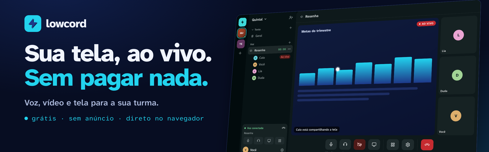
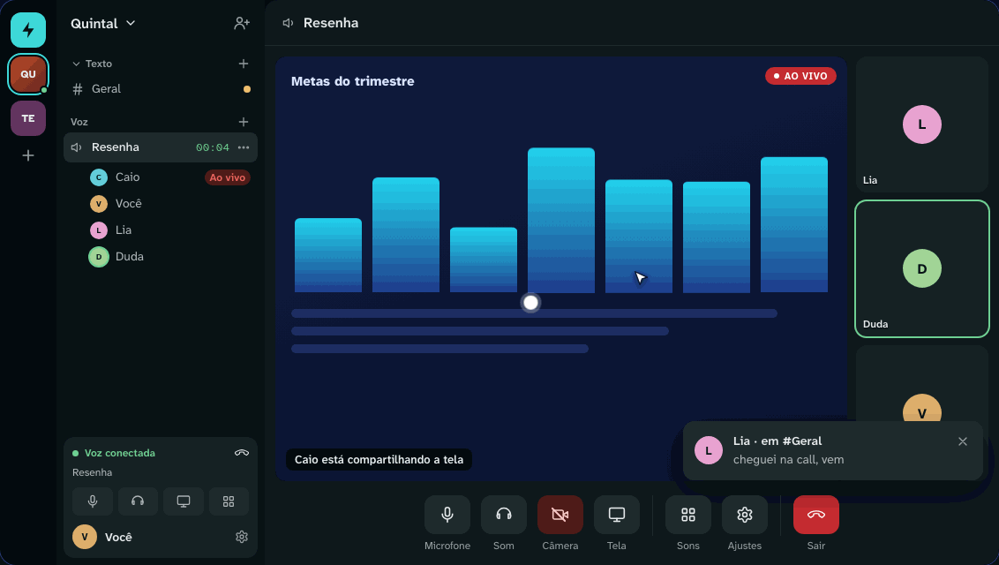
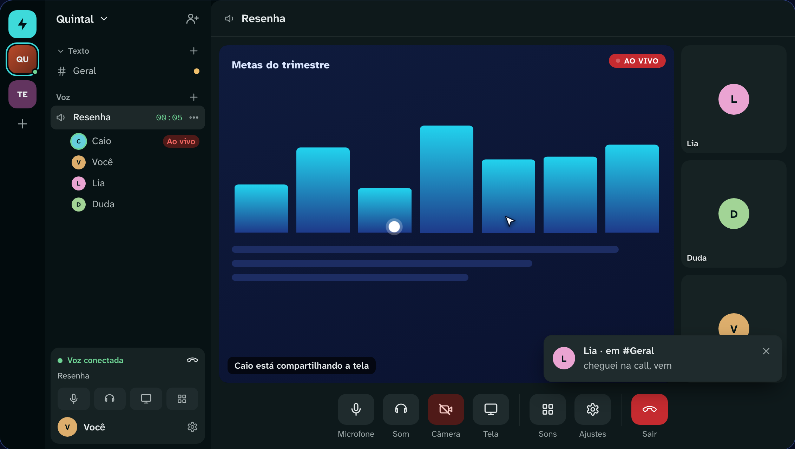
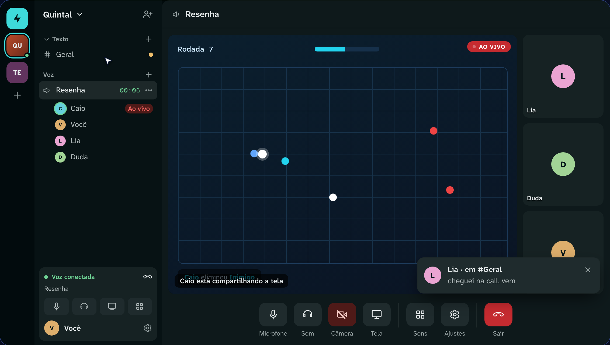
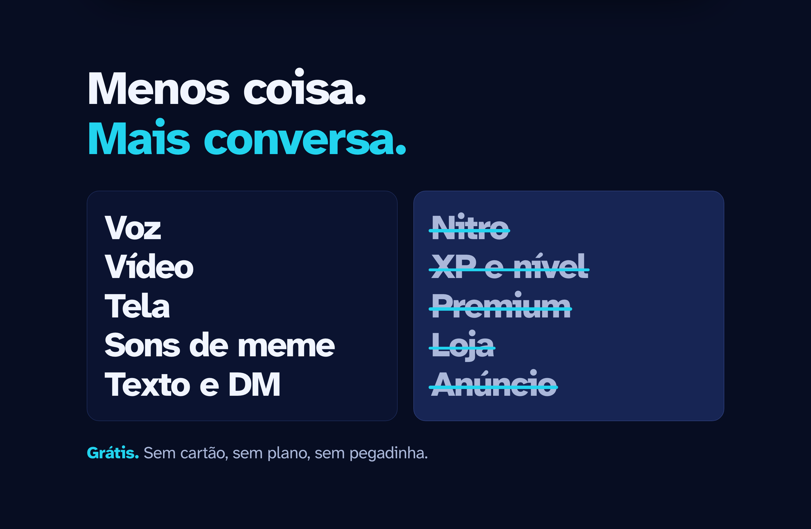
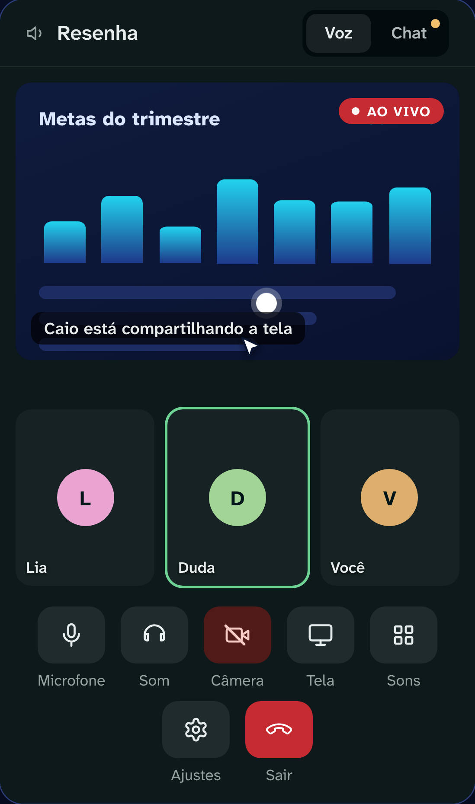

  

<h3 align="center">Chat de voz, vídeo e tela para a sua turma, grátis e sem anúncio.</h3>

  <a href="https://lowcord.com.br/register"><b>➜ Criar conta grátis</b></a>
  &nbsp;·&nbsp;
  <a href="https://lowcord.com.br">lowcord.com.br</a>
  &nbsp;·&nbsp;
  <a href="https://www.youtube.com/@Lowcord">YouTube</a>
  &nbsp;·&nbsp;
  <a href="https://www.tiktok.com/@lowcord.br">TikTok</a>

  

O **Lowcord** é um lugar para a sua turma conversar por voz, ligar a câmera e mostrar a tela, direto no navegador. Para jogar, trabalhar ou estudar, sem Nitro, sem XP, sem premium: só o essencial.

## Veja como é

  
  

> As telas acima usam uma comunidade de exemplo, com nomes e conteúdo fictícios.

## O que tem

- **Chamadas** de voz, vídeo e compartilhamento de tela
- **Comunidades** com canais de texto e de voz
- **Mensagens** nos canais e **conversas diretas**, com arquivos e imagens
- **Amigos:** ache qualquer pessoa pelo nome
- **Sons de meme** para animar a call
- **Convites com prazo:** só entra quem você chamar
- **Sem instalar nada:** funciona no navegador, no computador e no celular
- **Conta segura:** e-mail e senha com verificação em duas etapas, ou entre com o Google

## Menos coisa, mais conversa

  

| | Lowcord |
|---|:---:|
| Grátis, sem cartão e sem plano | ✅ |
| Sem anúncio | ✅ |
| Sem Nitro, XP, premium ou loja | ✅ |
| Voz, vídeo e compartilhamento de tela | ✅ |
| Funciona no navegador, sem instalar | ✅ |
| Convite com expiração | ✅ |
| App para baixar (celular ou computador) | ❌ ainda não |

## No celular

  

Abre no navegador do celular, com texto e voz. Para compartilhar a tela, o computador é o melhor caminho.

## Como começar

1. **Crie a conta** em [lowcord.com.br](https://lowcord.com.br/register), com e-mail e senha ou com o Google.
2. **Crie a comunidade**: dê um nome e monte os canais de texto e de voz.
3. **Mande o link** de convite: quem recebe entra direto, sem instalar nada.

  <a href="https://lowcord.com.br/register"><b>➜ Criar conta grátis</b></a>

## Perguntas frequentes

<b>É de graça mesmo?</b>

É. Sem assinatura, sem plano pago e sem anúncio.

<b>Qualquer um entra na minha comunidade?</b>

Não. Só entra quem tem o seu convite, e o convite tem prazo.

<b>Preciso instalar alguma coisa?</b>

Não. Funciona no navegador, no computador e no celular. Ainda não existe app para baixar.

<b>Dá para usar no celular?</b>

Dá. Abre no navegador do celular, com texto e voz. Para compartilhar a tela, o computador é o melhor caminho.

<b>Posso entrar com a minha conta do Google?</b>

Pode. É uma alternativa ao e-mail e senha.

## Sobre este repositório

Este repositório existe só para apresentar o projeto. **O código-fonte do Lowcord é privado.**

Dúvidas ou sugestões: escreva para [contato@lowcord.com.br](mailto:contato@lowcord.com.br) ou abra uma *issue* aqui.
